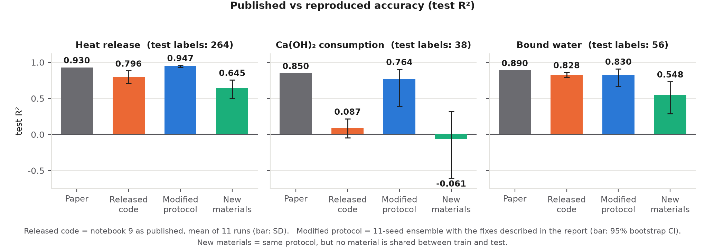
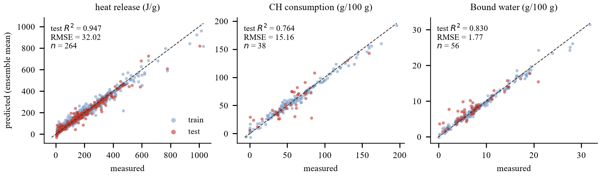
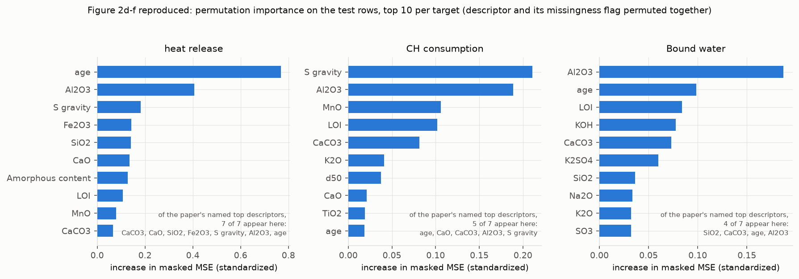
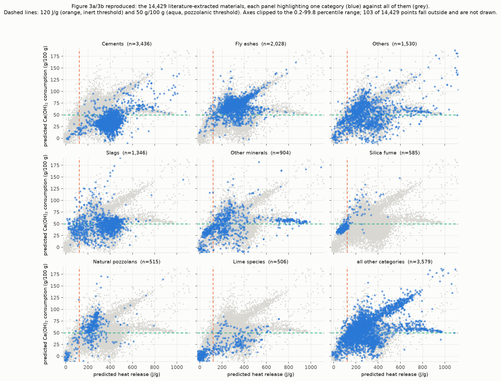
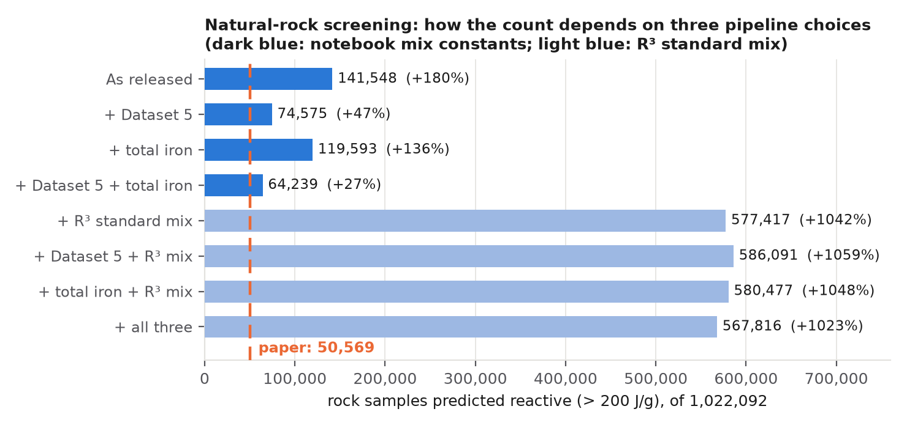
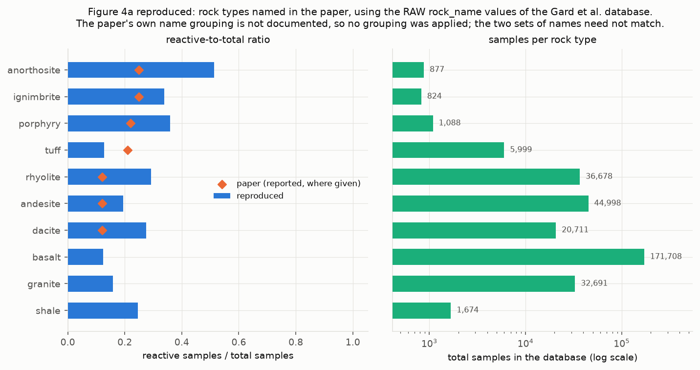
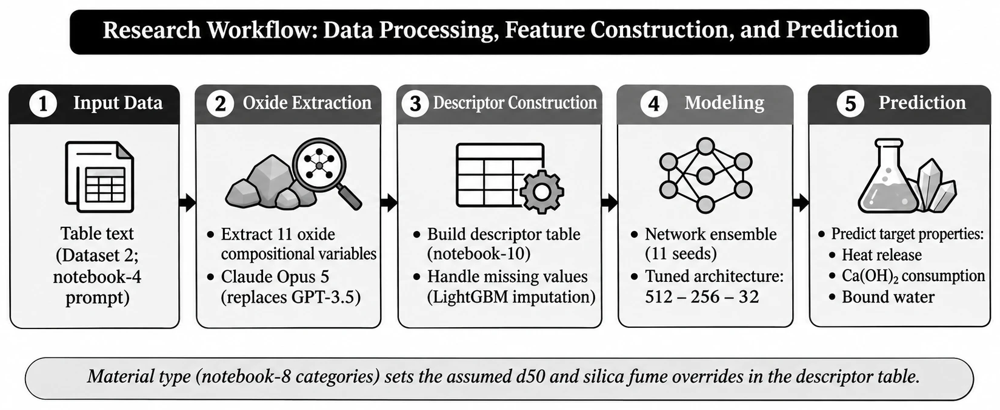

# Replicating a data-driven screening framework for cementitious precursors

A replication study of **Mahjoubi, Venugopal, Manav, Azarijafari, Kirchain & Olivetti, *Data-driven material
screening of secondary and natural cementitious precursors*, Communications Materials 6, 99 (2025)**
([article](https://www.nature.com/articles/s43246-025-00820-4)).

The paper trains a neural network that predicts how reactive a material will be in cement (three outputs of the
R³ test: **heat release**, **Ca(OH)₂ consumption**, **bound water**) from its oxide composition, then uses it to
screen 14,429 literature-extracted materials and about one million natural rock samples. This repository runs the
authors' released code, compares the results with the paper, and documents what could and could not be reproduced.

| | |
|---|---|
| **Full report (6 pages)** | [`report/REPLICATION_REPORT_FINAL.pdf`](report/REPLICATION_REPORT_FINAL.pdf) · [`.docx`](report/REPLICATION_REPORT_FINAL.docx) |
| **Original paper** | <https://www.nature.com/articles/s43246-025-00820-4> |
| **Original code (authors')** | <https://github.com/olivettigroup/Cementitious-reactivity-prediction-and-discovery> at commit [`2340ec8`](https://github.com/olivettigroup/Cementitious-reactivity-prediction-and-discovery/tree/2340ec87eb3a8f5d564528f08a85f509887c811c) |
| **This repository** | <https://github.com/Shotabdychy/cementitious-reactivity-replication> |

> **Start here:** read the [key findings](#key-findings) and the [report](report/REPLICATION_REPORT_FINAL.pdf).
> Everything below is backed by files in [`results/`](results/) and [`logs/`](logs/).

---

## Key findings

|  | Finding | Evidence |
| ---: | --- | --- |
| 1 | **The released notebook 9 is unstable.** Ca(OH)₂ test R² averages 0.087 over 11 runs and its early stopping failed in 11 of 11. | [Results §1](#1-model-accuracy), [report §3.2](report/REPLICATION_REPORT_FINAL.pdf) |
| 2 | **With a corrected training protocol the model reaches the published accuracy for heat release** (R² 0.947 vs 0.93) **and approaches it for the other two** (0.764 vs 0.85; 0.830 vs 0.89), though those two rest on only 38 and 56 test labels. | [Results §1](#1-model-accuracy) |
| 3 | **It does not generalise to unseen materials:** with no material shared between train and test, Ca(OH)₂ R² drops to -0.061. | [Results §1](#1-model-accuracy) |
| 4 | **The published rock count (50,569) was not reproduced:** 141,548 as released; no variant of the pipeline matches it. | [Results §4](#4-natural-rock-screening) |
| 5 | **Extraction step works with a substitute model:** 240 of 241 oxide values match the manual ground truth. | [Results §5](#5-literature-extraction-demonstration) |



---

## Results

### 1. Model accuracy

Test-set accuracy of the three-output network. The test set has 370 rows; each target is labelled on
only some of them (heat release 264, Ca(OH)₂ 38, bound water
56), so the Ca(OH)₂ and bound-water figures are noisy.

| Setting | Heat release<br>R² / RMSE (J/g) | Ca(OH)₂ consumption<br>R² / RMSE (g/100 g) | Bound water<br>R² / RMSE (g/100 g) |
| --- | :---: | :---: | :---: |
| Published (Mahjoubi et al.) | 0.930 / 28.20 | 0.850 / 12.17 | 0.890 / 1.47 |
| Released code as published, 11 runs (mean ± SD) | 0.796 ± 0.087 / 59.98 | 0.087 ± 0.130 / 29.46 | 0.828 ± 0.033 / 1.91 |
| Modified protocol, released architecture, 11-seed ensemble | 0.956 / 29.14 | 0.776 / 14.78 | 0.844 / 1.70 |
| **Modified protocol, tuned architecture, 11-seed ensemble** | **0.947 / 32.02** | **0.764 / 15.16** | **0.830 / 1.77** |
|   95% CI of that ensemble (R²) | [0.933, 0.960] | [0.396, 0.905] | [0.669, 0.910] |
| Tuned ensemble, **new materials** (no material shared by train and test) | 0.645 / 88.68 | -0.061 / 48.43 | 0.548 / 4.56 |
| Test labels (row-level split / grouped split) | 264 / 311 | 38 / 45 | 56 / 59 |

*"Released architecture" = 256-256-16 ReLU layers. "Tuned" = 512-256-32, dropout 0.2,
L2 0.001, learning rate 2.33×10⁻³, batch 128; chosen by 5-fold cross-validation on the
training rows only (the test set was never used to choose anything).*

**How to read this.**

- **Released code as published:** all 11 runs trip a collapse rule defined on validation behaviour only
  (monitored value 26.7-800, never below 1). The notebook's early-stopping metric is averaged over
  validation batches of 50 rows; with only 192 Ca(OH)₂ labels in 1,849 rows, most batches hold none or one label, so
  the metric is NaN or about 10⁶ and the restored epoch is essentially arbitrary.
- **Modified protocol** (my addition, not in the paper) changes four things at once: whole-validation-set early stopping,
  a random validation split stratified on which target is labelled, training-only preprocessing, and a stratified outer
  split. **Their separate effects were not isolated.** A "clean" variant that keeps the original monitor but removes the
  leakage still collapses in 7 of 11 runs (Ca(OH)₂ R² 0.567 ± 0.151),
  which is consistent with the monitor mattering but does not prove it.
- **Tuning did not help:** the released hyperparameters scored slightly higher on the test set than the tuned ones. The
  cross-validation-selected configuration was kept anyway, because choosing by test score would be selection on the test set.
- **Overlapping confidence intervals do not show equivalence**; they show the test sets are too small to separate the two.
- **New materials:** Dataset 4 has 1,849 rows but only 277 distinct materials, mostly measured at several ages. With a
  split that keeps each material on one side, accuracy falls sharply while the training fit stays high. The paper does
  not state how its split was made, so this is a measure of how much the split matters, not a correction of a published number.



*Measured vs predicted values for the tuned ensemble (training and test rows).*



*Permutation importance (top 10 per target). The paper's named descriptors (age, Al₂O₃, CaCO₃, Fe₂O₃, specific gravity,
SiO₂, CaO) all appear in the heat-release top 10, with `age` first. A [SHAP summary](figures/fig2_shap_sound_tuned.png)
gives a second view.*

### 2. Library versions

The paper states Python 3.8; only Python 3.11 was available, so **Python 3.8 was not used**. One faithful run was
repeated with older libraries (TensorFlow 2.12.0, pandas 1.5.3): heat-release R² changed from
0.781 to 0.871, but Ca(OH)₂ stayed at
0.128 vs 0.127 - so the Ca(OH)₂ problem is
not a library-version effect.

### 3. Literature-extracted materials

The ensemble scores all 14,429 materials in Dataset 1. The paper's qualitative claims reproduce:

| Category | Materials | Median heat release (J/g) | Median Ca(OH)₂ consumption (g/100 g) | Share above 50 g/100 g |
| --- | ---: | ---: | ---: | ---: |
| Metakaolin | 242 | 546 | 103 | 97% |
| Fly ashes | 2,028 | 332 | 70 | 87% |
| Slags | 1,346 | 359 | 47 | 43% |
| Cements | 3,436 | 402 | 32 | 10% |
| Lime species | 506 | 86 | 10 | 10% |

The authors' count of materials above 380 J/g with bound water above 10 g/100 g (964) **cannot be tested** without their
trained weights; this ensemble gives 4,918, and individual seeds range from
2,031 to 6,749.



### 4. Natural-rock screening

Notebook 11 as released, scored with the ensemble over all 1,022,092 rock samples, calls
**141,548** reactive against the paper's **50,569**, and the count varies from
92,639 to 462,245 between seeds. Three pipeline choices were varied one at a time and together:

| Pipeline variant | Samples predicted reactive (> 200 J/g) | vs. paper (50,569) |
| --- | ---: | ---: |
| As released (notebook 11 unchanged) | 141,548 | +180% |
| + Dataset 5 in the imputation pool | 74,575 | +47% |
| + Fe₂O₃ taken as total iron | 119,593 | +136% |
| + Dataset 5 and total iron | 64,239 | +27% |
| + R³ standard mix instead of notebook constants | 577,417 | +1042% |
| + Dataset 5 and R³ mix | 586,091 | +1059% |
| + total iron and R³ mix | 580,477 | +1048% |
| + all three | 567,816 | +1023% |



- Adding Dataset 5 (rocks with *measured* amorphous content) lowers the imputed amorphous content from
  56.4% to 27.1%. The released notebook does not use Dataset 5, although the paper describes it.
- Using the real R³ mix recorded in Dataset 4 instead of the notebook's constants multiplies the count by about
  4, so the result is very sensitive to those constants.
- **No combination reproduces 50,569**, so no single factor explains the gap. The pozzolanic/hydraulic split reported in
  the paper has no rule in the released code; the thresholds explored here are my own.



*Reactive share for the rock types the paper names, using the raw database names (the paper's name grouping is undocumented).*

### 5. Literature-extraction demonstration

Notebooks 1-8 need a private paper corpus and the authors' fine-tuned OpenAI models, so they could not be run. As a
substitute, **Claude Opus 5** was given the notebook-4 prompt and the table text from Dataset 2 (replies written before
any ground truth was read) and scored against two references. The substitute model measures the *task*, not the authors' system.



| Table (Dataset 2 row) | Materials extracted | Exact oxide values vs. manual ground truth (Dataset 2) | Exact oxide values vs. authors' output (Dataset 1) |
| --- | ---: | ---: | ---: |
| Row 191: Mortar samples | 16 | 111 / 112 | 85 / 86 |
| Row 107: Normal cements | 14 | 84 / 84 | 0 / 0 |
| Row 105: Cement kiln dust | 8 | not scorable† | 62 / 62 |
| Row 1: Cement and fly ashes | 5 | 45 / 45 | 45 / 45 |
| **Total** | 43 | **240 / 241** | **192 / 193** |

† The Dataset 2 ground truth for row 105 describes a different table. The two comparisons cover different tables
(rows 191, 107 and 1 against the manual ground truth; rows 191, 105 and 1 against the authors' output), so the two
counts should not be compared with each other. The single disagreement in either is the MgO of sample SNM 7: the
source table gives 1.57, while both the manual ground truth and Dataset 1 record 1.87. Classification of material
type agreed on 36 of 40 unseen Dataset 3 rows (90%; the paper reports 97%, on a different label scheme).

**Worked example - material HL1, a high-lime fly ash** (the table captioned "Properties of cement and fly ashes used";
table text and manual values from Dataset 2, DOI [`10.1016/s0008-8846(99)00160-x`](https://doi.org/10.1016/s0008-8846(99)00160-x) from the matching Dataset 1 rows,
paper details from Crossref: M. Tokyay, *Cem. Concr. Res.* 29, 1737-1741, 1999). Oxide contents in wt%:

| Source | SiO₂ | Al₂O₃ | Fe₂O₃ | CaO | MgO | SO₃ | TiO₂ | MnO | K₂O | Na₂O | LOI |
| --- | ---: | ---: | ---: | ---: | ---: | ---: | ---: | ---: | ---: | ---: | ---: |
| Extracted (Claude Opus 5) | 43.3 | 25.1 | 4.9 | 20.3 | 0.8 | 2.5 | - | - | 1.3 | 0.2 | 1.19 |
| Manual ground truth (Dataset 2) | 43.3 | 25.1 | 4.9 | 20.3 | 0.8 | 2.5 | - | - | 1.3 | 0.2 | 1.19 |
| Authors' output (Dataset 1) | 43.3 | 25.1 | 4.9 | 20.3 | 0.8 | 2.5 | - | - | 1.3 | 0.2 | 1.19 |
| Model input after imputation (*italic* = imputed) | 43.3 | 25.1 | 4.9 | 20.3 | 0.8 | 2.5 | *1.18* | *0.17* | 1.3 | 0.2 | 1.19 |

TiO₂, MnO, specific gravity (2.66 g/cm³) and amorphous content (54.2%) are not in the table
and were imputed; d50 (8.88 µm) and the mix and test conditions are the notebook-10 constants.

| Prediction for HL1 | From the extracted values | Same ensemble, authors' Dataset 1 row |
| --- | ---: | ---: |
| Heat release (J/g) | 417.6 | 411.6 |
| Ca(OH)₂ consumption (g/100 g) | 76.1 | 78.9 |
| Bound water (g/100 g) | 23.9 | 23.4 |

---

## What was done, and what was not

| Stage | Notebooks | Status |
|---|---|---|
| Literature filtering, table and sentence retrieval | 1-3, 6 | **Not run** - needs the group's private paper corpus |
| Table extraction, material typing | 4, 5, 7, 8 | **Demonstrated on a sample** with a substitute model (Section 5) |
| Reactivity network | 9 | **Run**: as published, "clean", and modified protocol with tuning, 11 seeds, ensemble, grouped splits |
| Literature materials | 10 | **Run** with the ensemble |
| Natural rocks | 11 | **Run** with the ensemble and an 8-variant ablation |

Five files that the notebooks load are **not in the authors' repository** (`R3.csv`, `natural_rocks.csv`,
`df_imputed.pkl`, and two trained `.keras` models). They were rebuilt from the supplementary datasets (see
[`data/README.md`](data/README.md)); comparisons with values the authors left in saved notebook cells are therefore
reported as *untestable*, not as failures.

**Limitations.** Individual protocol changes were not isolated; the Ca(OH)₂ and bound-water test sets are small; the
extractor is a substitute; Python 3.8 was not used; and not every run was repeated in the verification pass
([`logs/verify.log`](logs/verify.log)). Details are in the [report](report/REPLICATION_REPORT_FINAL.pdf), Section 5.

---

## Repository layout

```
report/         REPLICATION_REPORT_FINAL.pdf / .docx    the 6-page report
scripts/        all code written for this replication
environment/    requirements.txt (main), requirements_legacy.txt (library-version check)
data/           README.md: where each input comes from and how missing files were rebuilt
results/        JSON / CSV that the report quotes      (index: results/README.md)
  few_papers/   substitute-extractor replies, scores, mismatches, worked example
figures/        all figures
logs/           stdout of every run                     (index: logs/README.md)
```

**Original vs. this work.** The authors' notebooks are *not* copied here (MIT-licensed; clone them at the commit above).
Every file in `scripts/` was written for this replication; `nb9_faithful.py` re-types notebook 9's loss functions,
architecture and loss weights as published, and says so in its docstring.

| Script | Role |
|---|---|
| `common.py` | shared data loading, losses, model, splits, metrics, name matching |
| `nb9_faithful.py` | notebook 9, as published and "clean" variants |
| `nb9_tune.py` | KerasTuner random search, 5-fold CV on training rows only |
| `nb9_final.py` | modified protocol: N seeds, ensemble, bootstrap CIs, grouped splits |
| `nb10_run.py`, `nb11_ablation.py` | notebooks 10 and 11 with the ensemble; the rock ablation |
| `figures.py`, `fig_summary.py` | figures (the workflow diagram `figures/fig_workflow.png` is a supplied image, not generated) |
| `few_papers_*.py`, `worked_example.py` | extraction demonstration and the HL1 example |
| `make_tables.py`, `make_docx.py`, `docx_to_pdf.ps1` | summary tables; the report (Word is needed for the PDF export) |
| `compare_runs.py`, `run_*.sh` | clean-start verification; batch runners |

---

## Reproducing the results

**1. Environment** (Python 3.11 was used; versions are pinned)

```bash
pip install -r environment/requirements.txt
```

**2. Inputs.** Put the supplementary datasets in `data/supplementary/` and the Gard et al. rock tables in `data/gard/`
(or set `REPL_DATA` and `REPL_GARD`). See [`data/README.md`](data/README.md).

**3. Run** (from `scripts/`; seeds are 42 and 1-10, outer split seed 0, bootstrap seed 7)

```bash
python nb9_faithful.py faithful 42                       # notebook 9 as published (repeat for seeds 1-10)
python nb9_tune.py --trials 18 --folds 5                 # tuning (~65 min on 8 CPU cores)
python nb9_final.py --config tuned --seeds 11 --tag sound_tuned
python nb9_final.py --config tuned --seeds 11 --grouped material --tag grouped_material
python nb10_run.py --models sound_tuned
python nb11_ablation.py --models sound_tuned             # ~15 min
python figures.py --models sound_tuned
python few_papers_select.py && python few_papers_score.py && python few_papers_categories.py
python few_papers_predict.py --models sound_tuned && python worked_example.py
```

The extraction replies in `results/few_papers/responses/` were produced interactively by Claude Opus 5 from the prompts
that `few_papers_select.py` writes ([note](results/few_papers/EXTRACTOR_NOTE.md)); that step is not a scripted API call.
Trained models and row-level prediction tables are not committed; the commands above regenerate them.

---

## Notes

- **Licence.** The authors' code is MIT-licensed. The scripts in this repository carry no licence yet; add one before reuse.
- **Third-party material.** The supplementary datasets (CC BY-NC-ND) and the Gard et al. database are not redistributed.
- **Citation.** If you use this work, please cite the original paper (https://www.nature.com/articles/s43246-025-00820-4).
